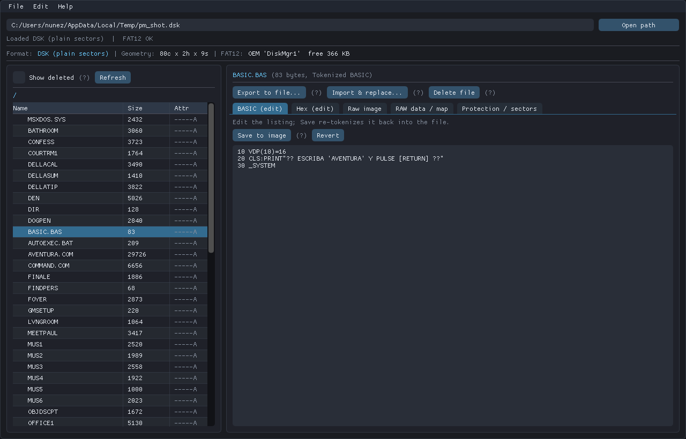
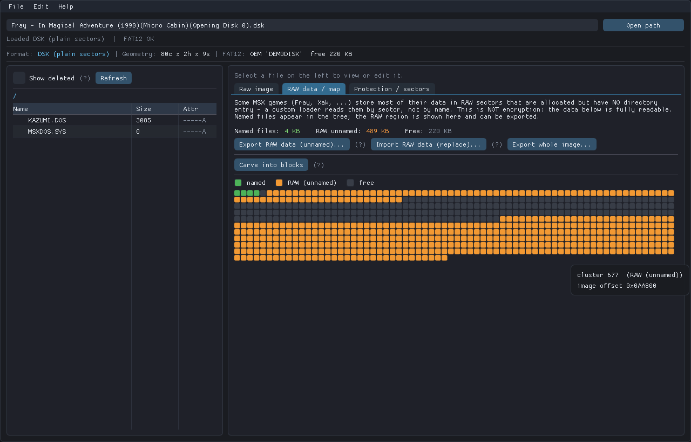

# MSXFileForge

[](https://github.com/GS-RUN/MSXFileForge/actions/workflows/build.yml)
[](LICENSE)

A native (C++/Dear ImGui) editor and inspector for **MSX** files, with first-class
support for reading **protected** and **RAW** disk images that a plain `.dsk`
cannot represent. Runs on **Windows, Linux and macOS** (both Intel x86_64 and
Apple Silicon arm64).



Many games catalogue only 1-2 files while the rest of the disk is uncatalogued
**RAW** sector data (read directly by a custom loader — not encryption). The
RAW browser makes it visible, exportable, re-importable and carvable:



It handles the whole MSX file stack:

| Domain | What it does |
|--------|--------------|
| **Disk images** | `.dsk` / raw sector dumps, and `.dmk` track images (protected disks). Auto-detects geometry (SS/DS, 360/720 KB). |
| **Protected / RAW** | A `.dmk` preserves the physical IDAM/sector layout, so copy-protected disks survive: non-standard sector sizes, deleted-data address marks, duplicate IDs and CRC anomalies are surfaced in a **sector inspector**. Many games (Fray, Xak, ...) show only 1-2 catalogued files while the rest of the disk is **RAW uncatalogued sector data** read directly by a custom loader (not encryption); a **cluster map + RAW extractor/importer + block carver** makes that data visible, exportable, editable-and-reimportable, and splittable into BLOAD/BASIC segments. |
| **FAT12 filesystem** | MSX-DOS disks: boot/BPB, FAT chains, root + subdirectories, volume label, free space, extraction, **deleted-entry recovery**, and full **read/write** — overwrite / grow / shrink / **add new files** / **rename** / **create folders** / delete (automatic cluster (re)allocation across both FAT copies), plus **format a blank disk** from scratch. |
| **Analysis / integrity** | CRC32 of files and images, a **filesystem check** (cross-links, broken chains, lost vs RAW clusters), and a **disk diff** (files only-in-A / only-in-B / differing by CRC). Optional `.bak` backup on save. |
| **MSX files** | Type detection (tokenized BASIC `0xFF`, BLOAD binary `0xFE`, ASCII, data), a full **BASIC detokenizer** and an inverse **tokenizer** (edit a listing as text and save it back tokenized). Handles standard + `0xFF`-extended tokens, hex/oct/int/BCD-float constants, line references, string & REM literals. |
| **Cartridge ROMs** | Size / page count, `AB` header + entry points (INIT/STATEMENT/DEVICE/TEXT), and **mapper detection** (None / Konami / Konami SCC / ASCII8 / ASCII16) via the openMSX-style write-target heuristic. |
| **Cassette** | `.cas` block layout (sync headers, ASCII / Binary / Tokenized-BASIC files), plus **conversion between `.cas`, `.tsx` and `.wav`**: export playable **WAV** audio (Kansas-City-Standard FSK, cas2wav-compatible), read/write **TSX** (TZX family with MSX `0x4B` KCS blocks), and decode a clean WAV recording back to `.cas`. |

## Layout

```
core/     pure C++17 library, no GUI deps  (disk_image, fat12, msxfile, rom, cas)
cli/      msxforge  — command-line driver (also the verification oracle)
gui/      msxforge-gui — Dear ImGui + SDL2 + OpenGL3 desktop app
tools/    dsk2dmk — re-encodes a .dsk into a DMK track image (used for testing)
libs/     vendored Dear ImGui 1.92.7 + SDL2 (self-contained)
```

## Build

Cross-platform (Windows / Linux / macOS). Pre-built binaries are produced by CI
on every push — grab them from the **Actions** tab. macOS ships as **two native
builds**: `msxforge-macos-x86_64` (Intel) and `msxforge-macos-arm64` (Apple
Silicon). The others are `msxforge-linux` and `msxforge-windows`.

On macOS the downloaded app is unsigned, so if Gatekeeper refuses to open it,
clear the quarantine flag first:

```sh
chmod +x msxforge*
xattr -cr msxforge-gui        # (also msxforge, dsk2dmk)
./msxforge-gui
```

**Linux / macOS** — needs a C++17 compiler, CMake and SDL2:

```sh
# Debian/Ubuntu: sudo apt install -y build-essential cmake libsdl2-dev libgl1-mesa-dev
# Fedora:        sudo dnf install -y gcc-c++ cmake SDL2-devel
# macOS:         brew install cmake sdl2
./build-unix.sh            # or: cmake -B build -DCMAKE_BUILD_TYPE=Release && cmake --build build -j
```

Native file dialogs on Linux use **zenity** or **kdialog** at runtime (install
one if your desktop lacks it).

The release binaries link the system SDL2 rather than bundling it, to stay
small and use your distro's up-to-date library. A fully self-contained
**AppImage** (Linux) or **.app** bundle (macOS) is intentionally *not* shipped —
if you want one, it is straightforward to build from these binaries and is left
to interested packagers.

**Windows** — SDL2 is bundled, so nothing to install:

```sh
./build.sh                # MinGW-w64 (g++), links the bundled SDL2.dll
# or with MSVC:  cmake -B build && cmake --build build --config Release
```

All targets produce `msxforge` (CLI), `msxforge-gui` (GUI) and `dsk2dmk`.

**Headless (no SDL2/OpenGL)** — build only the core, the CLI and the tests:

```sh
cmake -B build -DMSXFF_BUILD_GUI=OFF && cmake --build build -j
```

## Tests

`ctest --test-dir build --output-on-failure` runs two suites (CI runs them on
Linux, macOS arm64 and Windows):

- **core** (`tests/test_*.cpp`, no external framework): FAT12 create / overwrite
  / delete / rename / mkdir / rmdir, disk-full rollback, 8.3 validation, fsck on
  corrupted trees; the BASIC tokenizer byte-for-byte (constants, line numbers,
  `DATA`, `REM`/`'`, `ELSE`) and detokenize → tokenize round trips; DMK CRCs,
  deleted marks, duplicate IDs and odd tracks; ROM mapper detection; CAS ↔ WAV
  and CAS ↔ TSX round trips. `build/tests/msxff_tests <name>` runs a subset.
- **cli_smoke** (`tests/cli_smoke.cmake`): drives the `msxforge` binary end to
  end on a freshly formatted disk.

## CLI usage

Every `<FILE>` may be a path into subdirectories (`GAMES/SAVE/SLOT1.DAT`),
case-insensitive. Run `msxforge` without arguments for this list.

```
msxforge info    <image>              disk/format/geometry/FAT summary
msxforge ls      <image> [/PATH] [--deleted]
msxforge cat     <image> <FILE>       raw bytes to stdout
msxforge detok   <image> <FILE.BAS>   detokenize BASIC to stdout
msxforge tok     <text> [out.bas]     tokenize text BASIC (round-trip check)
msxforge extract <image> <FILE> <out>
msxforge put     <image> <FILE> <hostfile> [outimage]   overwrite a file
msxforge del     <image> <FILE|DIR> [outimage]          delete a file or an empty directory
msxforge protect <image>              physical sector / protection inspector
msxforge raw     <image> [out.bin]    cluster map (named/RAW/free) + extract RAW data
msxforge carve   <image>              split the RAW region into BLOAD/BASIC/gap blocks
msxforge rawput  <image> <hostfile> [outimage]   write RAW data back into the image
msxforge format  <out.dsk> [360|720]  create a blank formatted disk
msxforge add     <image> <hostfile> [/DIR] [NAME]   add a new file
msxforge rename  <image> <OLD> <NEW>
msxforge mkdir   <image> <NAME> [/PARENT]
msxforge crc     <image> [FILE]       CRC32 of a file or the whole image
msxforge fsck    <image>              filesystem integrity check
msxforge diff    <imageA> <imageB>    compare all files of two disks (exit 1 if they differ)
msxforge cas2wav <in.cas> <out.wav> [-2]   render tape to WAV (-2 = 2400 baud)
msxforge cas2tsx <in.cas> <out.tsx> [-2]   convert to TSX (TZX + MSX 0x4B KCS)
msxforge tsx2cas <in.tsx> <out.cas>        extract tape data from TSX
msxforge wav2cas <in.wav> <out.cas>        decode a (clean) WAV back to CAS
msxforge rominfo <rom>
msxforge cas     <cas>
```

## GUI

Drag a `.dsk` / `.dmk` / `.rom` / `.cas` onto the window, use **File > Open**
(Ctrl+O), or type a path. Then:

- Browse the FAT12 tree (directories in yellow, deleted files in red).
- **Edit** a file three ways: as a **BASIC listing** (re-tokenized on save), as
  **text**, or as **hex** (click a byte or use the offset/value poke box;
  changed bytes highlight yellow).
- **Import & replace**, **Export to file**, or **Delete** a file.
- **Save image** / **Save image as** (Ctrl+S / Ctrl+Shift+S) to persist.
- Inspect the physical sector table of protected images.
- Built-in **Manual** (Help > Manual / F1) and `(?)` tooltips throughout.

## Verified against real media

- FAT12 read on commercial disks (Master of Monsters = 81 files, Perry Mason =
  61/66) — file listing, subdir walk, byte-exact extraction (`AVENTURA.COM`,
  29 726 bytes).
- BASIC detokenizer on real loaders (`VDP(10)=16 : CLS : PRINT"…" : _SYSTEM`),
  with MSX graphic bytes preserved inside strings.
- ROM mapper detection on a real Konami SCC cartridge (Vampire Killer).
- **DMK end-to-end**: a `.dsk` re-encoded to `.dmk` yields the *identical*
  filesystem (same 61 files, same detokenized BASIC) read through the track
  container — proving the protected/RAW disk path.

## Editing & write verification

The edit → save → reopen pipeline (identical in CLI and GUI) is verified on real
media: overwriting a file grows/shrinks its cluster chain byte-exactly, both FAT
copies stay consistent, and unrelated files keep the same checksum. A BASIC edit
(change a line + add a line) round-trips through tokenize → write → reopen →
detokenize, and delete frees clusters and drops the entry.

## Honest limitations

- DMK ID/data **CRCs are verified** (and recomputed when a sector is written),
  and duplicate IDs / deleted marks are flagged, but this has been exercised on
  constructed images (`tests/test_disk.cpp`), not yet on a library of
  commercial copy-protected dumps. Single-density (FM) DMK tracks are parsed but
  not specifically tested.
- BASIC constants are converted exactly through their decimal digits. When a
  listing is produced, single-precision constants carry a `!` and integral
  double-precision constants that would otherwise read back as integers carry a
  `#`, so detokenize → tokenize reproduces the bytes; the real MSX `LIST` may
  print some of these without the suffix.
- Directories are created, grown and removed; the root directory keeps its fixed
  size (112 entries on standard disks), as on MSX-DOS.

## License

MSXFileForge is **free software** licensed under the **GNU General Public
License v3.0 or later** (see [`LICENSE`](LICENSE)). You may use and redistribute
it freely; **any modified version you distribute must be released under the same
GPL-3.0-or-later license** (copyleft / share-alike).

Bundled third-party components keep their own permissive, GPL-compatible
licenses: **Dear ImGui** (MIT), **SDL2** (zlib), **tinyfiledialogs** (zlib) and
**stb_image_write** (public domain). FAT12 handling is a clean C++ rewrite
informed by the sibling `dsk2rom` FAT tooling.

    Copyright (C) 2026 Alonso (GS·RUN)
    This program is free software: you can redistribute it and/or modify it
    under the terms of the GNU General Public License as published by the Free
    Software Foundation, either version 3 of the License, or (at your option)
    any later version. This program is distributed WITHOUT ANY WARRANTY.
